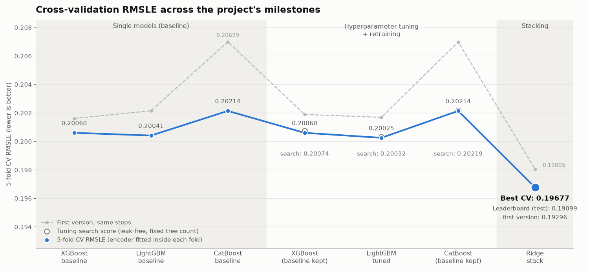
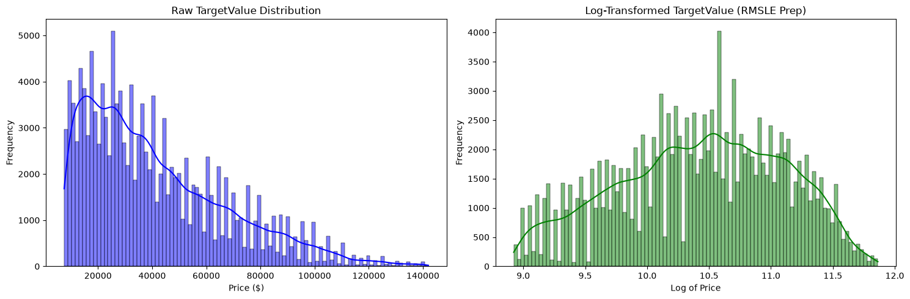
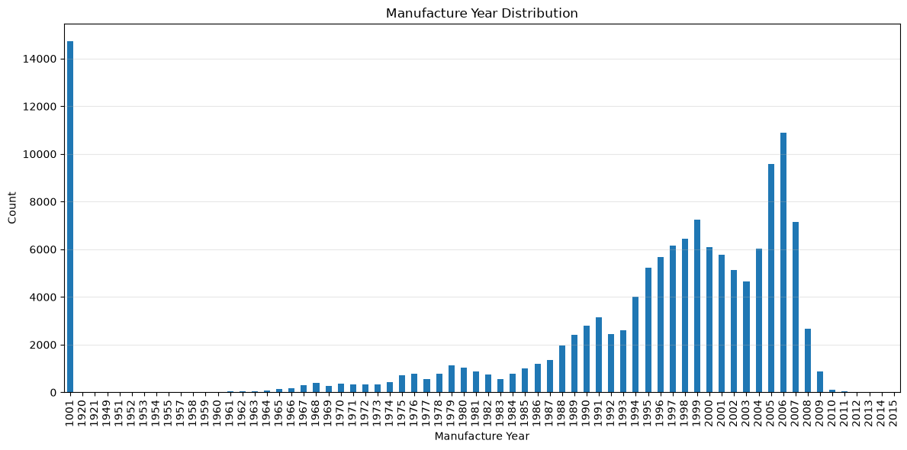
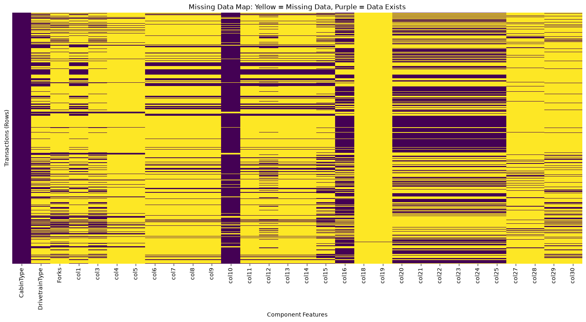
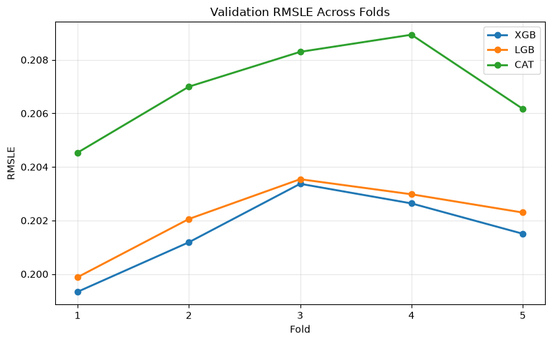
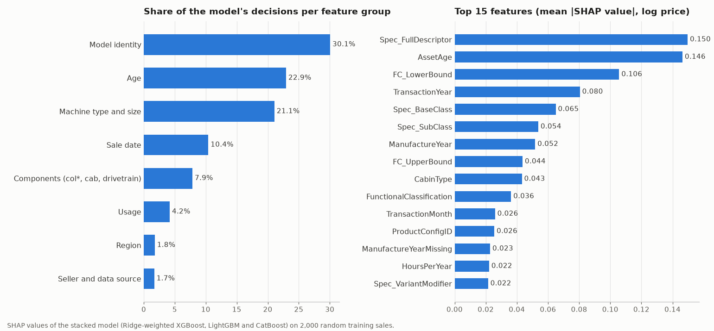
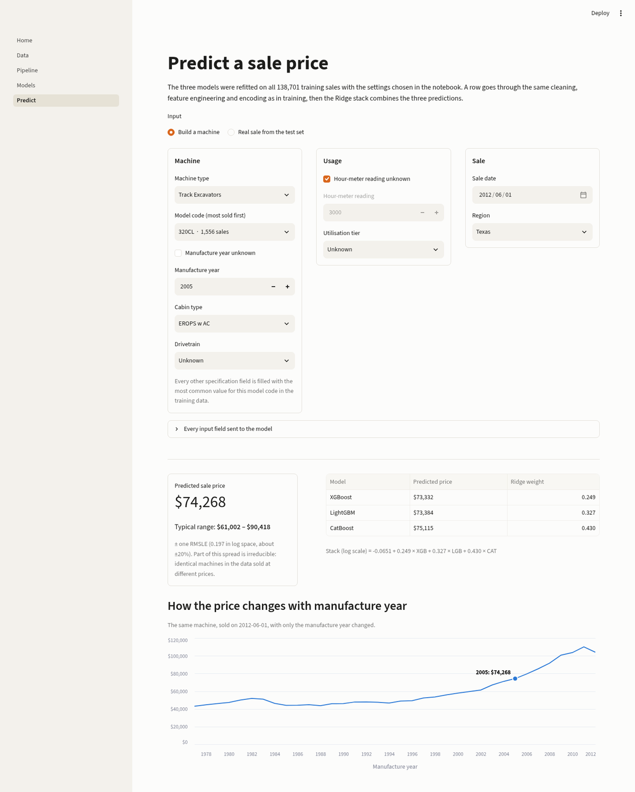

# Heavy Equipment Selling Price Prediction

**Gradient-boosted ensembles with leak-aware target encoding for pricing used industrial machinery from sparse, high-cardinality tabular data**

## Abstract

This project predicts the sale price (`TargetValue`) of used heavy equipment such as backhoe loaders, motor graders, track excavators, track-type tractors and wheel loaders. Each record has 50 transactional, geographic and technical attributes.

The data is unusually hostile to modelling:

- **47.9% of all cells are missing, and not one of the 138,701 training rows is complete.** Another 534,061 cells hold the disguised placeholder `"None or Unspecified"`.
- **The model code has 3,505 levels, and half of them occur five times or fewer.**
- **Most columns are anonymised** (`col1`–`col30`), and **10.6% of manufacture years are a placeholder**.
- **The data has a hard noise floor.** Even machines with the same model code and the same manufacture year differ in price by about 0.30 in log space. Rows with identical features are sometimes sold at different prices.

Section 2 quantifies each of these problems.

The pipeline:

1. Explores and visualises the data.
2. Builds features from dates, machine age, usage hours, the functional classification label and measurement strings.
3. Trains XGBoost, LightGBM and CatBoost with 5-fold cross-validation. Smoothed target encoding is fitted inside each training fold.
4. Tunes each model with `RandomizedSearchCV`. The target encoder sits inside the search's `Pipeline`, so it is refitted inside every fold here too.
5. Combines the three models' out-of-fold predictions with a Ridge meta-model (stacking).
6. Writes `submission.csv` for the test set.

The work was split by model. Each model was first developed and tuned in its own notebook (kept in [`notebooks/versions/`](notebooks/versions/)). The three were then combined in [`notebooks/model_development.ipynb`](notebooks/model_development.ipynb).

A Streamlit app ([`app/`](app/), Section 10) explains the data and the pipeline and prices machines live with the final models.

| | |
|---|---|
| **Task** | Tabular regression · 138,701 training and 15,000 test transactions |
| **Metric** | Root Mean Squared Logarithmic Error (lower is better) |
| **Models** | XGBoost, LightGBM, CatBoost → Ridge stacking (5-fold) |
| **Best single model (5-fold CV)** | LightGBM (tuned): 0.20025 |
| **Stacked ensemble (5-fold OOF)** | **0.19677** |
| **Leaderboard (held-out test)** | **0.19099** |
| **Front end** | Streamlit app with live predictions (Section 10) |



The blue line shows the 5-fold CV score at each milestone, and the grey line shows the same steps in the first version of the pipeline. The hollow markers show the best score of the hyperparameter search. The search is leak-free and uses a fixed tree count, so it found little to gain: XGBoost and CatBoost kept their parameters, and LightGBM improved by 0.0001. The gains over the first version came from fixing the model settings (Section 5.4). The largest single step is still stacking the three models.

---

## Table of Contents

1. [Problem](#1-problem)
2. [Dataset](#2-dataset)
3. [Evaluation Metric](#3-evaluation-metric)
4. [Methodology](#4-methodology)
5. [Results](#5-results)
6. [Project Structure](#6-project-structure)
7. [Environment Setup](#7-environment-setup)
8. [Data Setup](#8-data-setup)
9. [Running the Notebook](#9-running-the-notebook)
10. [Streamlit App](#10-streamlit-app)

---

## 1. Problem

Each row is one completed sale of a piece of heavy machinery. A row contains system metadata, the sale region, the machine's manufacture year and hour-meter reading, a hierarchy of specification codes, and up to 30 component attributes such as cab type, drivetrain, tyre size, track width and arm reach.

The goal is to predict `TargetValue`, the sale amount in US dollars, for every `TransactionID` in the test set. This is a supervised regression problem.

---

## 2. Dataset

| File | Rows | Columns | Description |
|---|---:|---:|---|
| `train.csv` | 138,701 | 50 | Transactions including the target `TargetValue` |
| `test.csv` | 15,000 | 49 | Transactions to predict |
| `metadata.csv` | 50 | 2 | Plain-language description of every column |

### Feature groups

| Group | Columns | Notes |
|---|---|---|
| Identifiers | `TransactionID`, `AssetID`, `ProductConfigID` | `AssetID` has 120,111 values (nearly unique); `ProductConfigID` has 3,594 |
| Source and partner | `DataOriginCode`, `VendorPartnerID` | 6 and 31 values |
| Time | `TransactionDate`, `ManufactureYear` | Sales from 1990 to 2013 |
| Usage | `OperationalHoursMeter`, `UtilizationTier` | 40.8% and 63.6% missing |
| Specification | `Spec_FullDescriptor`, `Spec_BaseClass`, `Spec_SubClass`, `Spec_ReleaseSeries`, `Spec_VariantModifier` | 3,505 / 1,249 / 147 / 113 / 132 values |
| Classification | `FunctionalClassification`, `InventoryGroupCategory`, `InventoryGroupDescription`, `AssetScaleFactor` | e.g. *"Wheel Loader - 150.0 to 175.0 Horsepower"* |
| Location | `RegionCode` | 53 regions |
| Components | `CabinType`, `DrivetrainType`, `Forks`, `col1`–`col30` | Anonymised columns; `metadata.csv` describes each one |

### Difficulty at a glance

| Property | Measurement (training set) |
|---|---|
| Missing cells | **47.9%** of all cells (48.8% in test); **0** complete rows |
| Columns more than 50% / 80% empty | **24 / 15** of 50 |
| Disguised missing values | **534,061** cells equal to `"None or Unspecified"`, across 20 columns |
| Usable hour-meter readings | **36.4%** of rows (40.8% missing, 22.8% exactly 0) |
| Placeholder manufacture year | **14,719** rows (10.6%) with year 1001 |
| Model-code levels (`Spec_FullDescriptor`) | **3,505**: 776 seen once, 50% seen five times or fewer |
| Configuration levels (`ProductConfigID`) | **3,594**: 806 seen once, 51% seen five times or fewer |
| Model codes in test never seen in training | **80** |
| Anonymised component columns | **27** (`col1`–`col30`, with `col2`, `col17` and `col26` absent) |
| Target precision | **675** distinct prices; 97.9% are multiples of \$500 |
| Spread of log price within one model code + manufacture year | **0.30** (compared with 0.67 for the whole dataset) |

### Data challenges

**1. Skewed target.** Prices range from \$7,500 to \$142,000, with a median of \$35,000 and a mean of \$41,522. The distribution has a long right tail. `TargetValue` has only 675 distinct values, so sale prices appear to be rounded. Taking the log of the target makes the distribution much closer to normal.



**2. Placeholder years.** 14,719 rows (10.6%) have `ManufactureYear = 1001`. This value means *unknown*. It is not a real year. If it were used as-is, those machines would appear to be about 1,000 years old.



**3. Structured missingness.** Component columns are not missing at random. Each block of columns is filled in for one inventory group only:

| Inventory group | Rows | Component columns specific to this group |
|---|---:|---|
| Track Excavators (TEX) | 71,018 | `col20`–`col25` |
| Motor Graders (MG) | 23,405 | `col6`–`col9`, `col11`, `col13`, `col14` |
| Wheel Loader (WL) | 18,872 | `col29`, `col30` |
| Track Type Tractors (TTT) | 14,959 | `col27`, `col28` |
| Backhoe Loaders (BL) | 10,381 | `col4`, `col5` |
| Skid Steer Loaders (SSL) | 66 | `col18`, `col19` |



A missing component value therefore usually means *not applicable to this machine type*. The pipeline keeps this as its own category instead of dropping the columns.

**4. A long tail of rare categories.** The specification codes follow a long-tailed distribution. Half of the 3,505 model codes appear five times or fewer, and 776 appear only once. There is too little data to learn a reliable price for most of them. Simple ordinal codes carry no notion of price, and naive per-category averages overfit badly. This is why the pipeline uses *smoothed* target encoding fitted inside each fold. In addition, 80 model codes in the test set never appear in training, so the model must fall back to broader groupings for them.

**5. Missing values in disguise.** Real `NaN`s are only part of the problem. 534,061 cells across 20 columns contain the text `"None or Unspecified"`, a second kind of missing value that looks like a real category. The hour meter has the same issue. 40.8% of readings are missing and another 22.8% are exactly 0, so only about a third of machines have a usable usage figure. The surviving readings are themselves unreliable: the 99th percentile is 25,796 hours, but the 99.9th is 412,138 and the maximum is 1,729,600 hours, which is about 197 years of non-stop running.

**6. Anonymised and loosely documented features.** 27 component columns are named only `col1`–`col30`, and three numbers in that range are missing from the schema. `metadata.csv` gives only short, paraphrased descriptions such as *"The type of interface used for load-bearing and shock absorption"*, with no units or allowed values. Measurements mix formats and units inside a single column: `<12'`, `13"`, `26.5`, `16 inch`, `10' 2"`. Labels are inconsistent (`AutoShift` vs `Autoshift`). The data also contains impossible records: 7 machines are sold before their manufacture year, and 21 have manufacture years between 1920 and 1949.

**7. A hard noise floor.** Much of the price variation cannot be explained by the available features:

| Machines grouped by | Spread of log price within a group |
|---|---:|
| Nothing (whole dataset) | 0.671 |
| Model code | 0.327 |
| Model code + manufacture year | 0.300 |
| Model code + manufacture year + sale year + region | 0.144 |

Even when model code, manufacture year, sale year and region all match, the price still varies by about 0.14 in log space. That is roughly ±15% for otherwise identical machines. Only 46% of rows have such a match at all. 6,792 rows are exact duplicates of another row on every feature. In 71% of these 2,954 duplicate groups the machines sold at different prices, in one case 4.7 times apart. No model can resolve that difference. For comparison, the final ensemble reaches an RMSLE of 0.197.

**8. A changing market.** The median sale price moves with the economic cycle: \$31,000 in 1990, \$43,000 in 1992, \$32,500 in 2003, \$40,000 in 2007 and \$31,500 in 2010. The same machine is worth different amounts in different years. Sale-date features are therefore essential, and the model has to separate the market trend from depreciation.

---

## 3. Evaluation Metric

The project uses **Root Mean Squared Logarithmic Error (RMSLE)**.

```math
\text{RMSLE} = \sqrt{\frac{1}{n}\sum_{i=1}^{n}\big(\log(1+\hat{y}_i) - \log(1+y_i)\big)^2}
```

where $y_i$ is the actual selling price, $\hat{y}_i$ is the predicted selling price and $n$ is the number of observations. **Lower RMSLE is better.**

RMSLE measures **relative** error. A \$5,000 miss on a \$20,000 machine counts for more than the same miss on a \$120,000 machine. RMSLE equals the RMSE of $\log(1+y)$, so every model is trained with a squared-error objective on `log1p(TargetValue)`. Predictions are converted back with `expm1` and clipped at 0.

---

## 4. Methodology

```text
train.csv / test.csv
      │
      ▼
parse_functional_classification ─► machine family, drive type, capacity range, unit
clean_machine_measurements      ─► col7 / col15 / col21 / col22 as numbers
feature_engineering             ─► date parts, asset age, missing flags, "Not Applicable" fills
DataTransformer                 ─► median imputation, log hours, hours per year, ordinal encoding
      │
      ▼
5-fold KFold ── for each fold ───────────────────────────────────────┐
  SmoothedTargetEncoder (fitted on the training fold only)            │
  XGBoost  (ordinal + target-encoded features)                        │
  LightGBM (ordinal + target-encoded features)                        │
  CatBoost (ordinal features)                                         │
      │                                                               │
      ▼                                                               │
Out-of-fold predictions ─► Ridge meta-model (5-fold) ─► submission.csv
```

### 4.1 Feature engineering

| Feature | How it is built | Why |
|---|---|---|
| `TransactionYear`, `Month`, `Quarter`, `Day`, `DayOfWeek` | From `TransactionDate` | Captures market level and seasonality |
| `ManufactureYearMissing` | Year 1000 or 1001 → flag = 1 and year → `NaN` | Separates *unknown* from *old* |
| `AssetAge` | `TransactionYear − ManufactureYear`; negative values → `NaN` | Depreciation drives price |
| `HoursMissing` | Flag for a missing hour-meter reading | Missing hours can carry information |
| `OperationalHoursLog` | `log1p(hours)` after median imputation | Reduces the effect of extreme readings |
| `HoursPerYear` | `hours / (AssetAge + 1)` | Usage intensity, independent of age |
| `FC_MachineFamily`, `FC_DriveType` | Parsed from `FunctionalClassification` | Shared structure across model codes |
| `FC_LowerBound`, `FC_UpperBound`, `FC_Unit`, `FC_IsPlusRange`, `FC_RangeKnown` | Parsed capacity range, e.g. *150.0 to 175.0 Horsepower* | Turns a text label into an ordered size value |
| `col7_Numeric_Feet`, `col15_Numeric_Inches`, `col21_Numeric_Inches`, `col22_Total_Inches` | Parsed measurement strings | Lets tree models use physical size |
| `Missing_BaseClass` | Flag for a missing `Spec_BaseClass` | Missingness indicator |
| Component columns (`col*`) | Missing values filled with `"Not Applicable"` | Keeps structured missingness as a category |

**Dropped columns:** `TransactionID`, `AssetID` (nearly unique), `InventoryGroupCategory` (duplicates `InventoryGroupDescription`), and `col18` / `col19` (99.95% missing).

### 4.2 Encoding

- **`DataTransformer`** fills missing numeric values with the median. It then ordinal-encodes every categorical column. Unseen categories become −1, and so do missing values in the text columns that are not `col*` columns. (`fill_cols` was meant to fill those with `"Unknown"`, but pandas 3 reads text columns with the `str` dtype, so its `dtype == "object"` check selects nothing. Code −1 gives missing values their own category in the same way.)
- **`SmoothedTargetEncoder`** is applied to the 8 categorical columns with more than 20 levels: `VendorPartnerID`, `Spec_FullDescriptor`, `Spec_BaseClass`, `Spec_SubClass`, `Spec_ReleaseSeries`, `Spec_VariantModifier`, `FunctionalClassification` and `RegionCode`. It is computed on the log target:

```math
\text{TE}(c) = \frac{n_c\,\bar{y}_c + \alpha\,\bar{y}}{n_c + \alpha}, \qquad \alpha = 15
```

Rare categories are pulled toward the global mean $\bar{y}$. Unseen categories get $\bar{y}$. During training, the encoder is **fitted on each training fold only** and then applied to that fold's validation rows and to the test set. XGBoost and LightGBM use the target-encoded features. CatBoost uses the ordinal-encoded features only.

### 4.3 Models

#### Gradient boosting: learning from residuals

XGBoost, LightGBM and CatBoost are all **gradient-boosted decision trees**. Instead of one big model, they build many small trees one after another. Each new tree learns to fix the mistakes, the **residuals**, of all the trees before it.

The models predict the log price $y = \log(1 + \text{TargetValue})$, so minimising squared error on $y$ is the same as minimising RMSLE.

**Step 1: start with a simple guess.** Every machine is first predicted at the average log price:

```math
F_0(x) = \bar{y}
```

**Step 2: measure what is still wrong.** At each round $m$, compute every row's residual, the gap between the true value and the current prediction:

```math
r_i = y_i - F_{m-1}(x_i)
```

**Step 3: fit a tree to the residuals.** A new small tree $f_m$ is trained to predict these residuals. It does not learn the price itself, only the error that remains.

**Step 4: update the model.** Add the new tree, scaled down by the learning rate $\eta$:

```math
F_m(x) = F_{m-1}(x) + \eta \cdot f_m(x)
```

Steps 2–4 repeat for thousands of rounds. The learning rate is small ($\eta$ = 0.02 for XGBoost and LightGBM, 0.05 for CatBoost), so each tree fixes only a few percent of the remaining error. Many small corrections generalise better than a few large ones. Training stops early once the validation-fold score has not improved for 300 rounds. The final prediction is converted back to a price with $\text{expm1}$.

The three libraries follow this same recipe but grow their trees differently:

| | XGBoost | LightGBM | CatBoost |
|---|---|---|---|
| Tree growth | Leaf by leaf (`grow_policy="lossguide"`), limited by `max_leaves` | Leaf by leaf (best split first), limited by `num_leaves` | Symmetric trees: the same split across a whole level |
| Regularisation used | `reg_lambda`, `reg_alpha`, `min_child_weight` | `reg_lambda`, `min_child_samples` | `l2_leaf_reg` |
| Input | Ordinal + target-encoded features | Ordinal + target-encoded features | Ordinal features |

XGBoost and LightGBM grow their trees in a similar way on the same inputs. CatBoost, with symmetric trees on ordinal features, gives the most different view. Because the models still make partly different errors, stacking them helps (Section 4.4).

#### Model settings

All three models use seed 42 and early stopping after 300 rounds without improvement on the validation fold. XGBoost and LightGBM use a learning rate of 0.02 (up to 15,000 and 12,000 trees). CatBoost uses 0.05 (up to 20,000 trees).

| Model | Baseline parameters | Search grid (`RandomizedSearchCV`, 5 candidates × 5 folds) |
|---|---|---|
| **XGBoost** | leaf-wise, 255 leaves, min child weight 20, subsample 0.82, colsample 0.5, λ 2.5, α 0.15, `hist` | leaves {127, 255, 383}, min child weight {10, 20, 40}, subsample {0.75, 0.82, 0.9}, colsample {0.4, 0.5, 0.6}, λ {1, 2.5, 5}, α {0.05, 0.15, 0.5} |
| **LightGBM** | 255 leaves, min child samples 20, subsample 0.83 (every iteration), colsample 0.5, λ 3 | leaves {127, 255, 383}, min child samples {10, 20, 40}, subsample {0.75, 0.83, 0.9}, colsample {0.4, 0.5, 0.6}, λ {1, 3, 6} |
| **CatBoost** | depth 8, L2 5, RMSE loss | depth {7, 8, 9}, L2 {3, 5, 8} |

- **Leak-free search.** The target encoder and the model are wrapped in one `Pipeline`, so the search refits the encoder inside every fold. Its scores are not optimistic.
- **Grids centred on the current parameters,** one step either side. The learning rate is not searched, because it only matters together with the number of trees.
- **Fixed tree counts.** `RandomizedSearchCV` cannot stop early, so each candidate uses a fixed number of trees close to where early stopping ended: XGBoost 5,000, LightGBM 5,300, CatBoost 16,000.
- A model's tuned parameters are used only if the best search score beats its baseline CV score.

### 4.4 Validation and stacking

- **5-fold shuffled `KFold`** (seed 42). This gives an out-of-fold (OOF) prediction for every training row. Test predictions are averaged over the 5 folds.
- **Ridge regression** (α = 1.0) is the meta-model. It is trained on the three models' OOF log-predictions and scored with its own 5-fold CV. It is then refitted on all OOF predictions to produce the final test predictions.

---

## 5. Results

### 5.1 Baseline models (5-fold CV RMSLE)

| Fold | XGBoost | LightGBM | CatBoost |
|---:|---:|---:|---:|
| 1 | 0.19845 | 0.19792 | 0.19943 |
| 2 | 0.20021 | 0.20058 | 0.20218 |
| 3 | 0.20224 | 0.20186 | 0.20388 |
| 4 | 0.20142 | 0.20126 | 0.20401 |
| 5 | 0.20068 | 0.20042 | 0.20122 |
| **Mean** | **0.20060** | **0.20041** | **0.20214** |
| Std | 0.00128 | 0.00135 | 0.00172 |



### 5.2 Hyperparameter tuning

| Model | Baseline CV | Best search score | Decision | Best parameters |
|---|---:|---:|---|---|
| XGBoost | 0.20060 | 0.20074 | Baseline kept | (255 leaves, min child weight 10, subsample 0.82, colsample 0.4, λ 5, α 0.5 was the best candidate) |
| LightGBM | 0.20041 | 0.20032 | Tuned parameters used | 383 leaves, min child samples 10, subsample 0.75, colsample 0.4, λ 6 |
| CatBoost | 0.20214 | 0.20219 | Baseline kept | (depth 9, L2 5 was the best candidate) |

With the search leak-free, tuning changes little. The only switch, LightGBM, gains 0.00009, which is within run-to-run noise.

### 5.3 Retraining with the selected parameters and stacking

| Model | 5-fold CV RMSLE |
|---|---:|
| XGBoost (baseline) | 0.20060 |
| LightGBM (tuned) | 0.20025 |
| CatBoost (baseline) | 0.20214 |
| **Ridge stack** | **0.19677** (OOF) · 0.19676 (mean of folds) |
| **Ridge stack, leaderboard** | **0.19099** (held-out test) |

Stacking improves on the best single model (LightGBM, 0.20025) by about 0.0035 RMSLE.

The final Ridge (intercept −0.0651) gives each model this weight:

| Model | Ridge weight | Share |
|---|---:|---:|
| XGBoost | 0.249 | 24.8% |
| LightGBM | 0.327 | 32.5% |
| CatBoost | 0.430 | 42.8% |

CatBoost gets the largest weight although it is the weakest single model. XGBoost and LightGBM see the same inputs and grow their trees the same way, so their errors are very similar. CatBoost's symmetric trees on ordinal features make different errors, and the stack gains the most from those.

On the leaderboard the stacked submission scores **0.19099**, about 0.006 better than its CV score. Cross-validation is therefore a conservative estimate. If target information were leaking into the validation folds, the CV score would be the optimistic one instead.

### 5.4 Changes from the first version

The features, folds and stacking are unchanged. Only the model settings and the tuning step changed:

| Change | Why |
|---|---|
| **CatBoost:** up to 20,000 iterations at learning rate 0.05 (was 12,000 at 0.018) | The first version stopped at the 12,000 cap in every fold (best iteration 11,999), so CatBoost was still improving and early stopping never triggered. It now stops on its own between about 14,000 and 19,000 iterations (measured in a separate run with the same settings, which gave identical fold scores). |
| **Column sampling 0.5** for XGBoost and LightGBM (was 0.85) | Many columns overlap: the target-encoded specification codes, the functional classification, the year and the age. With half the columns per tree, the trees cannot all lean on the same few columns. |
| **Bigger trees:** 255 leaves for both (XGBoost grows leaf-wise instead of depth 8; LightGBM had 80 leaves) | Captures interactions such as model code × age × sale year |
| **LightGBM `subsample_freq=1`** | Without it LightGBM ignores `subsample`, so the first version never sampled rows |
| **Leak-free tuning** | The first search fitted the target encoder on all rows, so its scores were optimistic (e.g. XGBoost 0.19675 reported, 0.20189 after retraining). The encoder now sits inside the search's `Pipeline`. |

| | First version | This version |
|---|---:|---:|
| XGBoost | 0.20189 | 0.20060 |
| LightGBM | 0.20169 | 0.20025 |
| CatBoost | 0.20699 | 0.20214 |
| **Ridge stack (OOF)** | 0.19805 | **0.19677** |
| **Leaderboard** | 0.19296 | **0.19099** |

### 5.5 Feature importance

Which features does the final model rely on? This is measured with **SHAP values**. For one prediction, SHAP splits the predicted log price into a base value (the average prediction) plus one contribution per feature, and the contributions add up exactly to the prediction. They come from Shapley values in game theory, the fair way to split a shared result between players, and for tree models they can be computed exactly (TreeSHAP). XGBoost, LightGBM and CatBoost all have this built in.

The Ridge stack is a weighted sum of the three models, so the stack's contribution of a feature is the same weighted sum of the three models' contributions (0.249 × XGBoost + 0.327 × LightGBM + 0.430 × CatBoost). The importance of a feature is the average size of its contribution over 2,000 random training sales.



| Feature group | Share | Columns in the group |
|---|---:|---|
| Model identity | 30.1% | `Spec_FullDescriptor`, `Spec_BaseClass`, `Spec_SubClass`, `Spec_ReleaseSeries`, `Spec_VariantModifier`, `ProductConfigID`, `Missing_BaseClass` |
| Age | 22.9% | `ManufactureYear`, `AssetAge`, `ManufactureYearMissing` |
| Machine type and size | 21.1% | `InventoryGroupDescription`, `FunctionalClassification`, `AssetScaleFactor`, `FC_MachineFamily`, `FC_DriveType`, `FC_LowerBound`, `FC_UpperBound`, `FC_Unit`, `FC_IsPlusRange`, `FC_RangeKnown` |
| Sale date | 10.4% | `TransactionYear`, `TransactionMonth`, `TransactionQuarter`, `TransactionDay`, `TransactionDayOfWeek` |
| Components | 7.9% | `CabinType`, `DrivetrainType`, `Forks`, the component columns `col1`, `col3`–`col6`, `col8`–`col14`, `col16`, `col20`, `col23`–`col25`, `col27`–`col30`, and the parsed measurements `col7_Numeric_Feet`, `col15_Numeric_Inches`, `col21_Numeric_Inches`, `col22_Total_Inches` |
| Usage | 4.2% | `OperationalHoursMeter`, `OperationalHoursLog`, `HoursPerYear`, `HoursMissing`, `UtilizationTier` |
| Region | 1.8% | `RegionCode` |
| Seller and data source | 1.7% | `VendorPartnerID`, `DataOriginCode` |

Together these are all 61 features, each in exactly one group.

- **What the machine is, how old it is and how big it is** account for three quarters of the model's decisions. The single most important features are the model code (`Spec_FullDescriptor`) and the age (`AssetAge`).
- **The sale year matters on its own** (10.4%): the same machine is worth different amounts in different market years, as the data challenges in Section 2 showed.
- **Usage counts for little** (4.2%), because about two thirds of the hour-meter readings are missing or 0.
- Related features share the credit between them (for example `ManufactureYear` and `AssetAge` carry almost the same information), which is why the groups are easier to read than single features.
- SHAP shows what the models **rely on**, not what causes prices. The values come from the app's final models (Section 10), which were trained on all sales, and are computed on training sales; the cross-validation score remains the measure of accuracy on new data.

---

## 6. Project Structure

```text
heavy_equipment/
├── README.md
├── requirements.txt
├── .gitignore
├── .streamlit/
│   └── config.toml                          # theme of the Streamlit app
│
├── assets/                                  # figures used in this README
│   ├── experiment_progression.png
│   ├── target_distribution.png
│   ├── manufacture_year_distribution.png
│   ├── missing_data_map.png
│   ├── validation_rmsle_across_folds.png
│   ├── streamlit_predict.png
│   └── feature_importance.png
│
├── app/                                     # Streamlit app (Section 10)
│   ├── Home.py                              # overview page, entry point
│   ├── pages/
│   │   ├── 1_Data.py
│   │   ├── 2_Pipeline.py
│   │   ├── 3_Models.py
│   │   └── 4_Predict.py
│   ├── pipeline.py                          # the notebook's preprocessing + prediction
│   ├── common.py                            # cached data/models and formatting helpers shared by the pages
│   ├── export_artifacts.py                  # refits the final models on all data and saves them
│   ├── compute_importance.py                # SHAP feature importance of the saved models (Section 5.5)
│   └── artifacts/                           # saved models (not tracked)
│
├── scripts/                                 # the notebook's pipeline as Python scripts (Section 9)
│   ├── config.py                            # paths and every setting: model parameters, grids, seeds
│   ├── features.py                          # data loading, feature engineering, encoders
│   ├── train.py                             # model definitions and the 5-fold CV training loop
│   ├── tune.py                              # leak-free RandomizedSearchCV
│   ├── stack.py                             # Ridge stacking and the submission file
│   └── run_pipeline.py                      # runs everything, entry point
│
├── notebooks/
│   ├── model_development.ipynb              # final pipeline: EDA → features → 3 models → tuning → stacking → submission
│   └── versions/                            # milestone notebooks (one model each)
│       ├── README.md
│       ├── training_xgboost.ipynb
│       ├── training_lightgbm.ipynb
│       └── training_catboost.ipynb
│
└── models/                                  # saved predictions / model artifacts (not tracked)
```

- `notebooks/model_development.ipynb` is the main notebook. It combines the three models, their tuning and the stacking step, and writes `submission.csv`.
- `notebooks/versions/` holds the single-model notebooks the final pipeline was built from. They share the same EDA and feature-engineering steps, and each one trains and tunes one model. The team developed them in parallel, one notebook per member. See [`notebooks/versions/README.md`](notebooks/versions/README.md) for their scores.

- `scripts/` contains the same pipeline as the notebook as plain Python modules, so it can be run with one command.
- `app/` is the Streamlit front end. It reuses the notebook's preprocessing code and the final models (Section 10).

The datasets (`*.csv`), model files (including `app/artifacts/`), script outputs (`outputs/`), CatBoost logs (`catboost_info/`) and the virtual environment are excluded from Git through `.gitignore`.

---

## 7. Environment Setup

The project uses a Python virtual environment created inside the project directory.

### Python version

```text
Python 3.14
```

### Create the environment

From the project root:

```bash
python -m venv .
```

> **Note:** The virtual environment layout differs between Unix-based systems (`bin/`) and Windows (`Scripts/`).

### Activate the environment

| Platform / shell | Command |
|---|---|
| Linux / macOS (bash, zsh) | `source ./bin/activate` |
| Linux / macOS (fish) | `source ./bin/activate.fish` |
| Windows (Command Prompt) | `.\Scripts\activate` |
| Windows (PowerShell) | `.\Scripts\Activate.ps1` |

### Install dependencies

```bash
python -m pip install --upgrade pip
python -m pip install -r requirements.txt
```

The main libraries are `pandas`, `numpy`, `scikit-learn`, `xgboost`, `lightgbm`, `catboost`, `matplotlib` and `seaborn`, plus `streamlit` for the app. `requirements.txt` pins exact versions.

### Register the Jupyter kernel

```bash
python -m ipykernel install --user --name heavy-equipment-project --display-name "Heavy Equipment Project (Python 3.14)"
```

Select this kernel in VS Code or Jupyter when you work with the project notebooks.

### Verify the environment

```python
import sys
print(sys.executable)
```

The output should point to the project's virtual environment:

- Linux / macOS: `.../heavy_equipment/bin/python`
- Windows: `...\heavy_equipment\Scripts\python.exe`

---

## 8. Data Setup

The competition datasets are kept locally and are not committed to Git. Place `train.csv`, `test.csv` and `metadata.csv` in the **project root**. The notebooks read them from there (`../train.csv` relative to `notebooks/`).

```text
heavy_equipment/
├── train.csv
├── test.csv
├── metadata.csv
├── README.md
├── requirements.txt
└── notebooks/ ...
```

---

## 9. Running the Notebook

With the virtual environment activated, open `notebooks/model_development.ipynb` in VS Code or Jupyter, select the project kernel and run all cells.

The notebook:

1. Loads and explores the data.
2. Builds features and encodes the data.
3. Trains the baseline XGBoost, LightGBM and CatBoost models with 5-fold CV.
4. Tunes each model with `RandomizedSearchCV` (leak-free, see Section 4.3).
5. Retrains with the selected parameters.
6. Fits the Ridge stacking model.
7. Writes `notebooks/submission.csv` (15,000 rows: `TransactionID, TargetValue`).

Training runs on the CPU. No GPU is needed. Hyperparameter tuning is the slowest step: each model runs 25 fits, about 30 seconds to 1.6 minutes each for XGBoost and LightGBM and 2 to 3.5 minutes each for CatBoost (about 2 hours in total on a 12-thread CPU).

### Running the scripts instead

`scripts/` holds the same pipeline as plain Python, without the EDA plots. From the project root:

```bash
python scripts/run_pipeline.py                  # full run in the notebook's order: baseline, tuning, retraining, stacking (about 2 hours)
python scripts/run_pipeline.py --skip-tuning    # train once with the parameters tuning chose in the notebook (about 30-40 minutes)
```

Both write `outputs/submission.csv` and each model's out-of-fold and test predictions (`outputs/*_oof.npy`, `outputs/*_test.npy`).

| File | What it contains |
|---|---|
| `config.py` | Paths and every setting in one place: fixed and tunable model parameters, search grids, seeds, the target-encoding alpha. `SELECTED_PARAMS` holds what tuning chose in the notebook (only LightGBM changed) |
| `features.py` | `SmoothedTargetEncoder`, `parse_functional_classification`, `clean_machine_measurements`, `feature_engineering`, `DataTransformer`, and `prepare_data()`, which loads the CSVs and returns `X`, `y_log`, `X_test` and the target-encoded columns |
| `train.py` | `build_models()` and `train_models()`, the 5-fold CV loop with in-fold target encoding and early stopping |
| `tune.py` | `tune_model()` with the encoder inside a `Pipeline`, and the search versions of the models with fixed tree counts |
| `stack.py` | Ridge stacking with its own 5-fold CV, the final Ridge weights and `write_submission()` |
| `run_pipeline.py` | Runs the steps above in order |

The code is the notebook's code, organised into functions. Running the notebook's own cells side by side with the scripts gives identical `X`, `X_test`, `y_log` and target-encoded columns, and identical parameters for every model, search model and grid. The only addition is the `.reindex(columns=[0, 1])` in `parse_functional_classification`, which makes it work on a single row and does not change the output on the full data.

### Output of a full run

**Stacking.** The Ridge meta-model scores the same on its training and validation folds (both average 0.19676). This means the stacking step itself does not overfit:

| Fold | Train RMSLE | Validation RMSLE |
|---:|---:|---:|
| 1 | 0.19736 | 0.19433 |
| 2 | 0.19680 | 0.19657 |
| 3 | 0.19635 | 0.19839 |
| 4 | 0.19646 | 0.19795 |
| 5 | 0.19681 | 0.19655 |
| **Overall OOF** | | **0.19677** |

**Early stopping.** In the retraining run, XGBoost stopped after about 5,200 to 6,000 trees and the tuned LightGBM after 3,578 to 4,989, both well before their limits.

**Submission.** `submission.csv` has 15,000 rows with one prediction per `TransactionID` and no missing values. The predicted prices follow the shape of the training target closely:

| | Min | 25% | Median | Mean | 75% | Max |
|---|---:|---:|---:|---:|---:|---:|
| Training `TargetValue` | \$7,500 | \$20,500 | \$35,000 | \$41,522 | \$57,000 | \$142,000 |
| Predicted (test) | \$7,314 | \$20,864 | \$34,625 | \$40,915 | \$56,139 | \$144,337 |

The predicted distribution is slightly narrower (standard deviation \$25,050 vs \$26,361). This is expected: averaging three models and five folds pulls the most extreme predictions toward the middle.

---

## 10. Streamlit App

The `app/` folder holds a Streamlit front end for the project. It explains the data and the pipeline, and it predicts prices live with the final stacked model.



| Page | Contents |
|---|---|
| **Home** | The problem, the RMSLE metric, why the target is log-transformed, headline scores |
| **Data** | Column groups and the main data challenges: placeholder years, block-wise missing values, rare model codes, disguised missing values, the noise floor and the changing market. A **Browse the data** tab filters all 138,701 sales (machine type, region, model code, year, price), sorts them and shows them 20 rows per page, either raw or after feature engineering |
| **Pipeline** | Flow diagram from the raw CSV to the final price, with an explanation of every step, and a walkthrough that follows one real sale through every step: raw values, parsed features, engineered features, encoding, each model's prediction and the final price next to the actual price |
| **Models** | Model settings, fold scores, tuning decisions, Ridge weights, the progression chart and the SHAP feature importance (by feature group and the top 20 features) |
| **Predict** | Pick a machine type and model code, change the manufacture year, hours, sale date, region, cab and drivetrain, and get the predicted price with each model's own prediction, a typical range, a plain-language "Why this price?" explanation, the model code's past sales, the model's own SHAP breakdown of the prediction (how much each feature group raised or lowered the price) and a depreciation curve. A second mode prices real sales from the test set |

### Running the app

With the virtual environment activated, from the project root:

```bash
python app/export_artifacts.py     # once, about 8 minutes: fits the final models and saves them to app/artifacts/
python app/compute_importance.py   # once, about 6 minutes: SHAP feature importance (no retraining)
streamlit run app/Home.py          # then open http://localhost:8501
```

- Run both commands from the project root. Streamlit reads the theme from `.streamlit/config.toml` in the folder it is started from.
- The overview pages work without the export step. Predict, the one-sale walkthrough and the "after feature engineering" view of the data browser need the saved models; the data browser and the model-code history also read `train.csv` from the project root.
- Every input and headline number has a hover help (ⓘ) that explains what it means.
- The saved models take 382 MB and are not tracked by Git (`lgb.txt` and `xgb.ubj` are also larger than GitHub's 100 MB file limit), so every fresh clone runs `export_artifacts.py` once. Loading them takes about 1 GB of RAM.

### How the Predict page works

- **Same preprocessing as training.** `app/pipeline.py` contains the notebook's preprocessing code (`SmoothedTargetEncoder`, `parse_functional_classification`, `clean_machine_measurements`, `feature_engineering`, `DataTransformer`), so a row typed into the app is transformed exactly like the training data. There is one change: in `parse_functional_classification`, `str.split(..., expand=True)` only creates the second column if at least one label in the batch contains a dash or a comma, which fails for a single row. The app's copy adds `.reindex(columns=[0, 1])`. The output on the full data is identical.
- **Final models.** `app/export_artifacts.py` refits the three models on all 138,701 training rows with the settings chosen in the notebook (LightGBM tuned, XGBoost and CatBoost baseline). Without a validation fold there is no early stopping, so each model gets a fixed tree count: the mean best iteration of the notebook's 5-fold run, scaled by 1.15 because the full data is 25% larger than a training fold. That gives XGBoost 6,650, LightGBM 4,950 and CatBoost 19,000 trees.
- **Stacking.** The three predictions are combined with the Ridge weights from the notebook (Section 5.3). The typical range shown is ± one stack RMSLE (0.197 in log space, about ±20%).
- **Autofill.** When a model code is picked, every field the form does not show is filled with the most common value for that model code in the training data.
- **Check against the submission.** On the 15,000 test rows the app's predictions correlate 0.9995 with `notebooks/submission.csv` (RMSLE 0.019 between the two, mean offset −0.2%). The small difference comes from using one full-data model per type instead of averaging five fold models. Predicting one row at a time gives exactly the same prices as predicting the whole test set at once.
- **Depreciation curve.** The curve rises steeply for machines built after about 1995 and is almost flat before that. Very old machines are rare in the data, and tree models cannot extrapolate beyond what they have seen.
